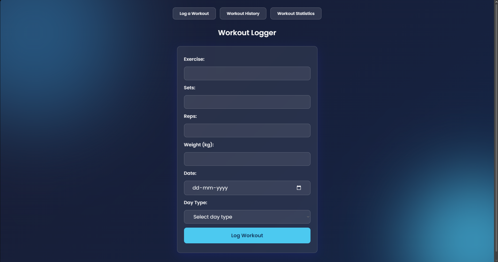
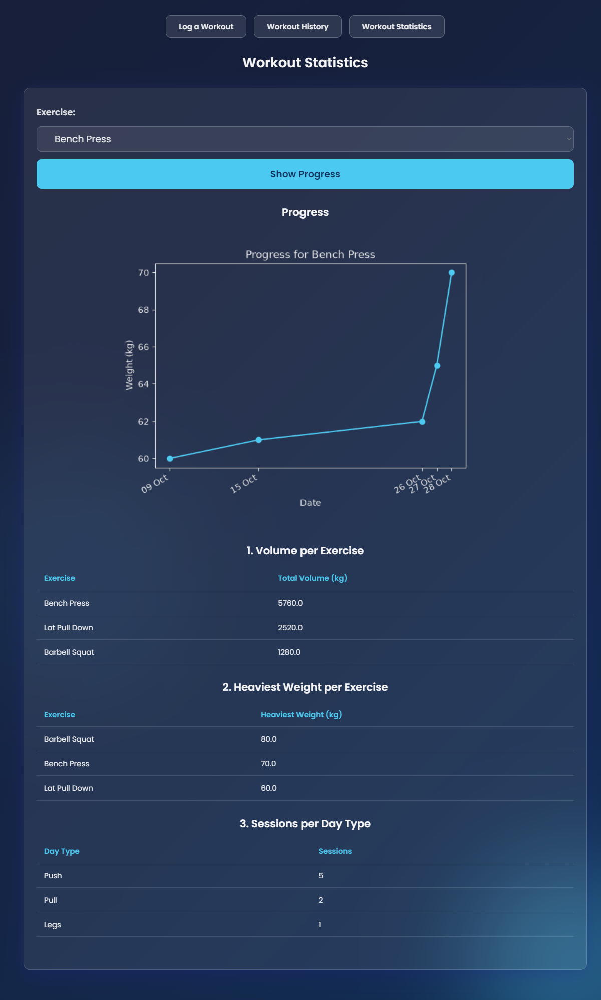

# Gym Log

A small Flask web app for logging gym workouts and tracking progress. Log each exercise with sets, reps, weight, date and day type (Push / Pull / Legs), browse your history, and see stats and a progression chart per exercise.




## Features

- **Log workouts** with server-side validation (see limits below) and the form keeps your input when there's an error
- **History** of all entries, newest first
- **Stats**
  - total volume per exercise (sets × reps × weight)
  - heaviest weight per exercise
  - sessions per day type (one session = one distinct date)
- **Progression chart** of the heaviest weight per day for any exercise you pick
- Responsive glassmorphism UI, checked down to phone width

## Tech stack

Python, Flask, SQLite (`sqlite3`), Jinja2 templates, Matplotlib, plain CSS.

## Setup

Tested with Python 3.14. The versions pinned in `requirements.txt` were generated on that version, so older Python versions may need different pins.

```bash
git clone https://github.com/Dsgamers903/gym-log.git
cd gym-log
python -m venv venv
```

Activate the virtual environment:

```bash
# Windows (PowerShell)
.\venv\Scripts\Activate.ps1

# macOS / Linux
source venv/bin/activate
```

Then:

```bash
pip install -r requirements.txt
python init_db.py      # creates gym_log.db
python app.py
```

Open http://127.0.0.1:5000

### Troubleshooting

- **`No module named 'flask'`** (or `matplotlib`): the virtual environment isn't active, or the requirements weren't installed. Activate it and run `pip install -r requirements.txt` before `python app.py`.
- **PowerShell says "running scripts is disabled"** when activating: run `Set-ExecutionPolicy -Scope CurrentUser RemoteSigned` once, then activate again.
- **Running `init_db.py` again is safe:** it only creates the table if it doesn't exist, so your data is kept.

## Validation limits

Exercise name up to 100 characters, sets 1–100, reps 1–1000, weight 0–1000 kg, date between 1900-01-01 and today, day type must be Push, Pull or Legs.

## Design decisions

- **Parameterized SQL queries** (`?` placeholders) for every query that uses input
- **Server-side validation:** the browser's checks are a convenience, the server re-checks everything
- **Exercise names are normalised on save** (trimmed, spaces collapsed, title case) so "bench press" and "Bench Press" land in the same group
- **Sessions are counted by distinct date,** so a day with six exercises counts as one workout
- **The chart is drawn on the server** with Matplotlib's object API and embedded in the page as a base64 image, so there is one route and no image files to manage

## Project structure

```
app.py             routes and chart helper
init_db.py         creates the database
requirements.txt   pinned dependencies
templates/         base.html, form.html, history.html, stats.html
static/            style.css
screenshots/       images used in this README
```

`gym_log.db` is created locally by `init_db.py` and is not tracked in the repo.

## Limitations and next steps

- No editing or deleting entries yet
- Single user, no login
- Runs with Flask's development server (`debug=True`), so it's for local use, not deployment
- Title-casing turns names like "EZ bar curl" into "Ez Bar Curl"
